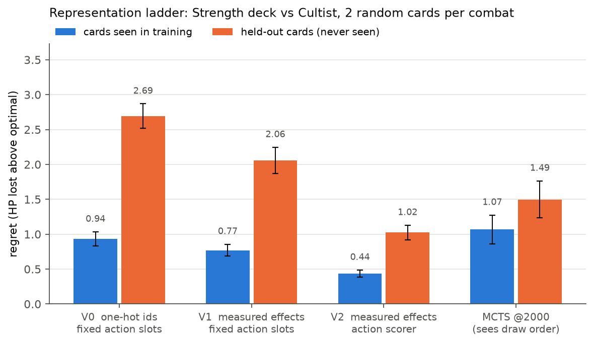
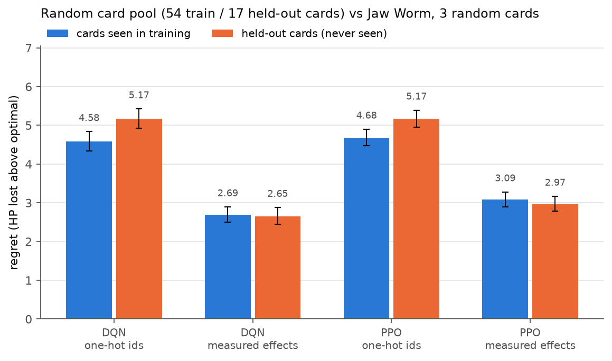
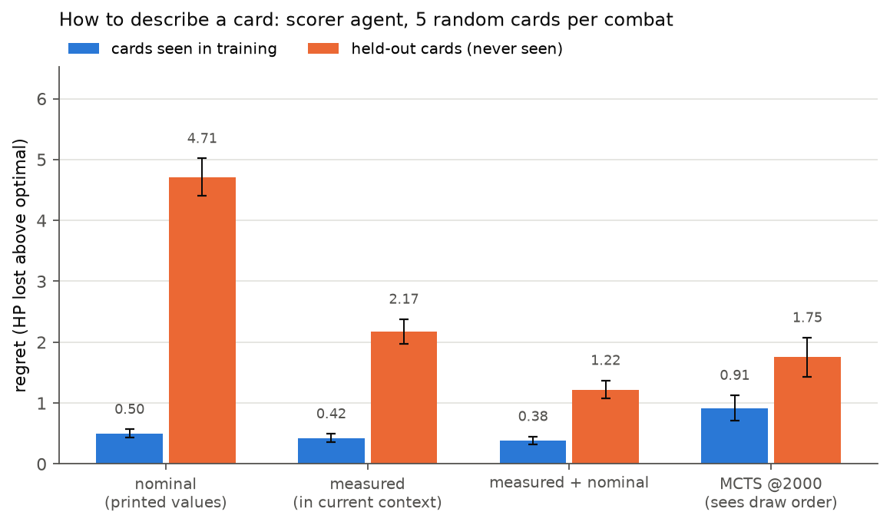

# Slay the Spire RL — combat agents that generalise to cards they have never seen

Deep RL agents for **Slay the Spire** combat (Ironclad, Act 1), trained in a fast headless C++ simulator.
The question is not "can an agent win a fight" but **"can it play well with cards it never saw during training?"**
— the situation a human player is in every time a new card shows up.

The main idea: **describe a card by what it does, not by what it is called.** Before each decision the
simulator state is cloned (≈2 µs) and every legal action is played once in the clone; the measured
change (damage, block, energy, statuses, draws, …) becomes the action's descriptor. A *scorer* network
then rates each candidate action from `(state, descriptor)`, so an unseen card is rated by its effect.



**Headline results** (regret = HP lost above an exact optimal player that *knows the draw order*; 500 paired combats; 3 training seeds; 95 % bootstrap CIs):

- **Effect descriptions + action scorer cut regret on unseen cards by 62 %** compared to one-hot card ids
  (2.69 → 1.02 HP, paired difference −1.67 [−1.85, −1.49]), and the gain is three times larger on unseen
  cards than on seen ones — the architecture improves *generalisation*, not just fitting.
- **Adding the printed ("nominal") values of a card to its measured effects** cuts regret on unseen cards by
  another 44 % (2.17 → 1.22 HP, −0.95 [−1.16, −0.75]) at no cost on seen ones.
- **On a random 54-card training pool, effect-based agents show no degradation on 17 held-out cards**
  (−0.04 HP, CI contains 0), while one-hot agents lose 0.5 HP.
- The blind agents (they do not know the draw order) **beat the reference MCTS that clones the RNG**
  (i.e. cheats) — and analysing why led to finding **two bugs in that MCTS** (see below).
- Tuning mattered more than the choice of algorithm: `gamma = 1` on ~15-decision episodes gave PPO −2.3 HP.

## Contents

1. [Setup](#setup) · 2. [Method](#method) · 3. [Results](#results) · 4. [Where the remaining gap lies](#where-the-remaining-gap-lies) · 5. [A bug in the reference MCTS](#side-finding-two-bugs-in-the-reference-mcts) · 6. [Limitations](#limitations) · 7. [Reproducing](#reproducing)

## Setup

| | |
|---|---|
| Simulator | [`sts_lightspeed`](https://github.com/gamerpuppy/sts_lightspeed) (C++, ~2 M steps/s on 24 threads) with the RL bindings patch from [`sts-rl-agent`](https://github.com/destire-mio/sts-rl-agent) |
| Episode | one combat. The deck, relics and HP are fixed by a scenario; the combat RNG seed changes every episode, so the **draw order and the enemy AI are hidden** (a POMDP: the *contents* of the draw pile are known, not its order) |
| Variable decks | each episode adds *k* cards drawn from a card pool. Pools are split into **training cards** and **held-out cards** that never appear during training |
| Encounters | Jaw Worm, Cultist (a race: it gains Strength every turn), Red Slaver, Gremlin Nob (elite) |
| Reward | +1 win / −1 loss, − HP lost / max HP each step, + 0.5 × fraction of enemy HP removed (dense shaping) |
| Evaluation | greedy policy, **500 paired combat seeds** disjoint from training seeds; every policy plays exactly the same combats, so differences are paired |
| Reference points | random policy · built-in heuristic · `mcts_recommend` @200 / @2000 simulations, which **clones the RNG and therefore sees the draw order** · **exact optimal play** by brute-force search with the draw order known (~3 000 nodes, 0.1 s per combat) |
| Metric | **regret** = HP lost − HP lost by the optimal player on the same combat. It makes pools of different difficulty comparable; 0 is unreachable for a blind agent |

## Method

**V0 — one-hot baseline.** Observation = player, enemies, and each hand slot as a one-hot card id (5 078 dims,
or 476 with a vocabulary restricted to the experiment). Action head = `Discrete(116)` masked: "card in hand slot *i* on target *j*", end turn, potions, card selections.

**V1 — measured effects.** Each hand slot is described by a **31-dim effect vector measured in the simulator**:
play the card in a clone of the combat and record the deltas (damage dealt, enemies killed, block, HP, energy,
Strength/Dexterity, Vulnerable/Weak applied, cards drawn/discarded/exhausted, and one delta per player status so
that Powers such as Demon Form become visible). No card identity is left in the observation.

**V2 — action scorer `Q(s, a) = f(state ⊕ φ(a))`.** Instead of a fixed 116-slot table, every legal action gets a
52-dim descriptor φ(a) (action type, cost/targeting/type, measured effects, target features), and one MLP scores
all candidates. The number of actions can vary, hand position disappears (two Strikes are the same action), and
weights are shared across candidates. Ending the turn is probed like any other action, so its descriptor contains
what the enemy turn will cost.

**Nominal values.** Measured effects are *contextual* (Strike deals 9 to a Vulnerable enemy). A card's **nominal**
vector is measured once in a neutral reference combat (Strike = 6, always) and cached; it acts as a stable,
identity-free signature of the card. `fx=both` concatenates the two.

**No information leak through the probe.** A clone shares the RNG state, so probing a random card would reveal its
outcome (Havoc would reveal the top card of the draw pile). `leak="mask"` replaces the measurement of the six
random-effect cards by their nominal values and raises an "uncertain" flag (used in the new experiment below; see
[Limitations](#limitations) for the earlier runs).

Algorithms: double DQN (main), MaskablePPO (sb3-contrib), REINFORCE with baseline. Code: [`src/stsenv/`](src/stsenv).

## Results

### 1. Fixed deck: hyperparameters before algorithms

Jaw Worm, starter deck, 400k steps, 3 training seeds. HP lost per combat (optimal player: 2.94, MCTS@2000: 5.03, heuristic: 6.99, random: 44.7).

| agent | HP lost |
|---|---|
| **DQN tuned, one-hot** | **4.77** |
| **DQN tuned, measured effects** | **4.78** |
| DQN default, one-hot | 5.64 |
| PPO tuned, measured effects | 5.52 |
| PPO default, one-hot | 8.66 |

- Default PPO settings (`gamma = 0.99`, 4 epochs) were the main reason it lagged: with `gamma = 1`, 10 epochs, lr 5e-4, the gain is **−2.33 HP [−2.53, −2.13]**.
- The best blind agent beats MCTS@2000, which sees the draw order: **−0.26 HP [−0.45, −0.07]**. In replays, the DQN learned to play Bash+ when the Jaw Worm buffs and to block when it attacks.
- Effects (429 dims) match one-hot (5 078 dims) here: with 3 distinct cards there is nothing to generalise yet.

### 2. Random card pool: no degradation on held-out cards



Jaw Worm, 3 cards drawn per combat from 54 training cards; evaluation on 17 held-out cards. The effect encoding
is better on both pools (DQN: −1.89 seen, −2.51 unseen) and **does not degrade on unseen cards** (−0.04 HP),
whereas one-hot degrades by +0.58 (DQN) and +0.49 (PPO). Part of the gap on *seen* cards is sample efficiency:
with a deck that changes every combat, one-hot has to learn 371 identities in 400k steps.

### 3. Representation ladder: the scorer head generalises better

Figure at the top. Strength deck (Inflame, Spot Weakness, Flex, Heavy Blade, Twin Strike, Pummel) vs Cultist,
2 cards per combat; held-out cards: **Limit Break** and **Sword Boomerang**. 300k steps, same DQN settings.

| | seen | unseen | V2 − V1 (paired) |
|---|---|---|---|
| V0 one-hot ids, fixed slots | 0.94 | 2.69 | |
| V1 measured effects, fixed slots | 0.77 | 2.06 | |
| **V2 measured effects, scorer** | **0.44** | **1.02** | seen −0.33 [−0.41, −0.26] · unseen **−1.03 [−1.21, −0.86]** |
| *MCTS @2000 (sees draw order)* | *1.07* | *1.49* | |

The scorer also needs **4× fewer environment steps** to reach 95 % of its final level (30k vs 120k), for 20 % more compute per step.

### 4. Describing a card: measured + nominal



Scorer agent, 5 cards per combat, 150k steps.

- **Nominal alone is worst on unseen cards** (4.71): without context the agent does not know what its card will actually do against a Vulnerable or blocking enemy.
- **Measured + nominal is best**: same as measured on seen cards (−0.04 [−0.12, +0.03]) but **−0.95 [−1.16, −0.75] on unseen cards**. The nominal vector is a context-free signature (two cards that do the same thing look the same), the measured one gives the value of the moment.
- A variant that describes the whole draw pile card by card (as a multiset, order excluded) did *not* pay off: it doubles the state size for information that is often missing.

### 5. Does card diversity at training time buy generalisation?

<!-- POOL_SIZE_SECTION -->

### Behaviour probes

On the Strength deck, the fraction of turn-1 hands with a Strength card where it is played *before* any attack:
58–65 % for DQN with effects, 38 % for MCTS@2000, 13 % for the heuristic. The agents learned to invest before
hitting, more consistently than the search baseline ([`behavior.py`](experiments/first_combat/behavior.py)).

## Where the remaining gap lies

[`gap_analysis.py`](experiments/first_combat/gap_analysis.py) compares each combat with the optimal line
(best agent, Cultist, 5 cards, unseen pool):

- 52 % of combats are played optimally and 69 % within 1 HP; the worst 5 % of combats carry 28 % of the regret.
- **It is a tempo problem.** Combats that end on the same turn as the optimal line cost 0.39 HP of regret on average; one turn late costs **5.08 HP** (the Cultist gains Strength every turn).
- The agent over-defends early (2.85 Defends per combat vs 2.52 optimal; opens with Strike in 16 % of combats vs 34 %).
- It **never plays Limit Break** (0.02 per combat vs 0.50 for the optimal line). With 0 Strength the card does nothing *now*, but it exhausts itself, which thins the deck for later draws — a delayed effect that neither the probe nor the per-step reward exposes.

This is a planning-horizon limit of one-step value learning, which motivates a learned transition model as the next step.

## Side finding: two bugs in the reference MCTS

The DQN beat `mcts_recommend` even though the MCTS knows the draw order. On one combat
(fixed-deck scenario, seed 306, turn 3: Jaw Worm at 19 HP with 6 block and Vulnerable, hand Strike ×4 + Bash+,
3 energy), the DQN plays three Strikes (27 − 6 = 21 ≥ 19, kill) while the MCTS plays Bash+ then Strike
(24 − 6 = 18: the Jaw Worm survives at 1 HP and hits for 14).

- Brute force finds 24 lethal lines in that state; the MCTS answers Bash+ at 200, 2 000, 20 000 **and 100 000** simulations, although its own evaluation prefers the kill (11 398 vs 9 997).
- A Python re-implementation of the same procedure finds the kill in 3 000 playouts; over 40 combats the C++ search misses **5 % of available lethal moves**, independent of budget.
- Causes found in `BattleScumSearcher2`: `bestActionValue` initialised with `std::numeric_limits<double>::min()` (the smallest *positive* double, not `lowest()`), so lines with negative evaluations never update the best sequence; and a UCT quality term normalised so that all wins look alike (~0.1 apart) against an exploration constant of 3√2. The search is also seeded deterministically from the combat seed, so it repeats the same mistake.

Scripts: [`diagnose_mcts.py`](experiments/first_combat/diagnose_mcts.py), [`emulate_scumsearch.py`](experiments/first_combat/emulate_scumsearch.py), [`lethal_check.py`](experiments/first_combat/lethal_check.py). Consequence for reading the tables: beating this MCTS is not the same as beating exhaustive search — the exact optimal player is the reference that matters.

## Limitations

- **One encounter per training run, Act 1 only**, and ≤ 5 random cards per combat. Full-run play (card rewards, map, shop) is out of scope.
- **Three training seeds per configuration.** Between-seed variation was small (±0.2 HP) but this is still a small sample.
- **Archetype pools are small** (6 training cards). On the Strength / Red Slaver / Gremlin Nob archetypes, all encodings degrade by +2 to +3 HP on held-out cards; with 6 training cards, the three encodings tie on seen cards, which suggests memorisation. Experiment 5 tests this directly.
- **Probe leak in earlier runs.** Results 1–4 were produced before `leak="mask"` existed. Against a single enemy (Cultist, Jaw Worm) Sword Boomerang's split cannot leak anything, but Havoc and True Grit could reveal hidden information when drawn. Experiment 5 uses the masked probe.
- The simulator exposes only 17 of its ~60 player statuses: Feel No Pain, Corruption, Juggernaut, etc. are invisible once played, for every encoding.
- An exact *blind* optimum (expectimax over beliefs) was implemented ([`blind_optimal.py`](src/stsenv/blind_optimal.py)) but costs ~2 min per belief: the reported bound is the clairvoyant optimum.

## Reproducing

```bash
# 1. Python environment (3.10+) and simulator
python -m venv .venv && source .venv/bin/activate
pip install -e ".[dev]"
bash scripts/setup_simulator.sh            # clones and builds sts_lightspeed into external/ (~1 min)
pytest                                     # environment invariants (7 tests)

# 2. Train and evaluate (example: the V2 scorer of experiment 3)
cd experiments/first_combat
export OMP_NUM_THREADS=1                   # mandatory with multiprocessing: 3.7x slower otherwise
python train_scorer.py --deck strength --encounter cultist --extra-cards 2 --steps 300000 --seed 0
python evaluate.py --deck strength --encounter cultist --extra-cards 2 --pool eval    # held-out cards
python evaluate.py --deck strength --encounter cultist --extra-cards 2 --pool train   # seen cards

# 3. Figures of this README, from the shipped evaluation files
python experiments/make_figures.py
```

[`REPRODUCE.md`](REPRODUCE.md) gives the command and run time for every table and figure.
`results/` contains the evaluation summaries and per-combat arrays (no checkpoints).

```
src/stsenv/            environments, encoders, policies, optimal solver
  combat_env.py          one-combat Gymnasium env, one-hot and measured-effect encoders
  scorer_env.py          V2/V3 state + per-action descriptors, nominal values, leak masking
  decks.py               deck archetypes and Act 1 encounters
  optimal.py             exact optimal play with known draw order (upper bound)
experiments/first_combat/
  train.py               DQN / PPO / REINFORCE with a fixed action table (V0, V1)
  train_scorer.py        DQN / REINFORCE with the action scorer (V2, V3)
  evaluate.py            paired evaluation of all checkpoints + references, bootstrap CIs, replays
  gap_analysis.py, behavior.py, lethal_check.py, diagnose_mcts.py   analyses
  run_*.sh               the experiment grids
results/first_combat/  evaluation summaries (eval*.json, eval_episodes*.npz)
```

## Acknowledgements

Simulator: [gamerpuppy/sts_lightspeed](https://github.com/gamerpuppy/sts_lightspeed). Python bindings patch and
the full-run agent used as a sanity check of the build: [destire-mio/sts-rl-agent](https://github.com/destire-mio/sts-rl-agent).
Slay the Spire is a game by Mega Crit; this project is not affiliated with them.

Implemented with the help of AI coding assistants; the concepts, experiments and intuitions are mine.
