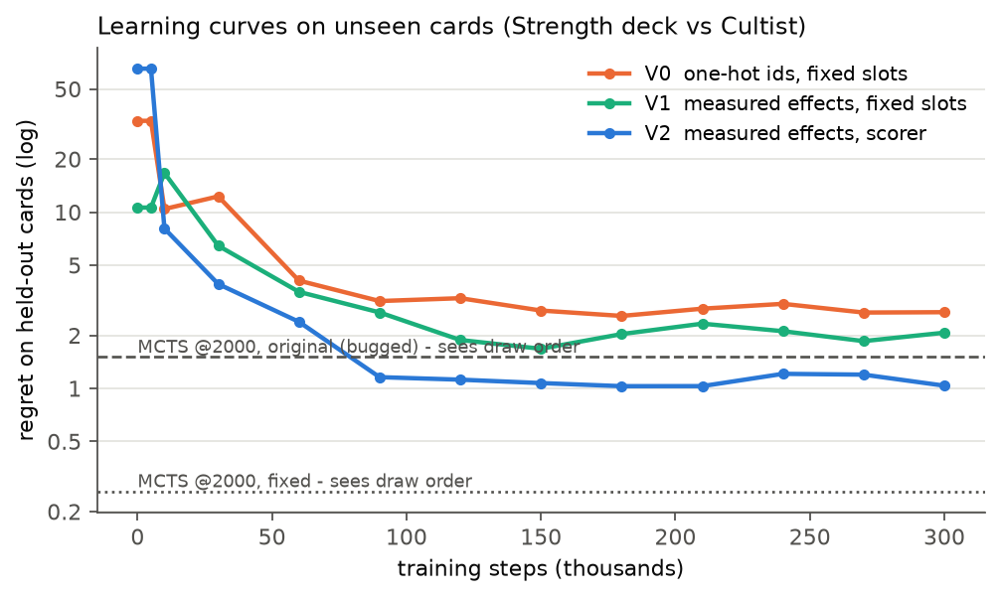
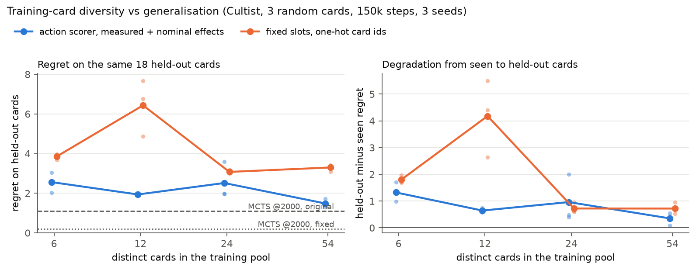

# Slay the Spire RL — combat agents that generalise to cards they have never seen

Deep RL agents for **Slay the Spire** combat (Ironclad, Act 1), trained in a fast headless C++ simulator.
The question is not "can an agent win a fight" but **"can it play well with cards it never saw during training?"**
— the situation a human player is in every time a new card shows up.

The main idea: **describe a card by what it does, not by what it is called.** Before each decision the
simulator state is cloned (≈2 µs) and every legal action is played once in the clone; the measured
change (damage, block, energy, statuses, draws, …) becomes the action's descriptor. A *scorer* network
then rates each candidate action from `(state, descriptor)`, so an unseen card is rated by its effect.


**Headline results** (regret = HP lost above the best known play on the same combat; 500 paired combats; 3 training seeds; 95 % bootstrap CIs):

- **Effect descriptions + action scorer cut regret on unseen cards by 61 %** compared to one-hot card ids
  (2.70 → 1.04 HP, paired difference −1.67 [−1.85, −1.49]), and the gain is three times larger on unseen
  cards than on seen ones — the architecture improves *generalisation*, not just fitting.
- **Adding the printed ("nominal") values of a card to its measured effects** cuts regret on unseen cards by
  another 44 % (2.17 → 1.22 HP, −0.95 [−1.16, −0.75]) at no cost on seen ones.
- **Card diversity at training time is what makes generalisation work**: with nested pools of 6 → 54 training cards,
  the gap between seen and held-out cards shrinks from +1.32 to +0.35 HP, and memorisation is visible with small pools.
  On a random 53-card pool, effect-based agents do no worse on 18 held-out cards than on seen ones.
- **I found and fixed a bug in the reference MCTS.** The blind agents seemed to beat the published search baseline,
  which clones the RNG and so sees the draw order. The reason was a UCT normalisation bug: after the first playout,
  the first root action got a score of ~10⁴ and *no other action was ever tried*. Fixed, the same search is close to
  best known play (regret 0.26 vs 1.04 for the scorer on unseen cards, at 2 000 simulations) and is the honest upper
  reference in every figure.
- Tuning mattered more than the choice of algorithm: `gamma = 1` on ~15-decision episodes gave PPO −2.3 HP.

## Contents

1. [Setup](#setup) · 2. [Method](#method) · 3. [Results](#results) · 4. [Where the remaining gap lies](#where-the-remaining-gap-lies) · 5. [The MCTS bug](#side-finding-a-bug-in-the-reference-mcts) · 6. [Limitations](#limitations) · 7. [Reproducing](#reproducing)

## Setup

| | |
|---|---|
| Simulator | [`sts_lightspeed`](https://github.com/gamerpuppy/sts_lightspeed) (C++, ~2 M steps/s on 24 threads) with the RL bindings patch from [`sts-rl-agent`](https://github.com/destire-mio/sts-rl-agent) and [our MCTS fix](patches/scumsearch_fixed_uct.patch) |
| Episode | one combat. The deck, relics and HP are fixed by a scenario; the combat RNG seed changes every episode, so the **draw order and the enemy AI are hidden** (a POMDP: the *contents* of the draw pile are known, not its order) |
| Variable decks | each episode adds *k* cards drawn from a card pool. Pools are split into **training cards** and **held-out cards** that never appear during training |
| Encounters | Jaw Worm, Cultist (a race: it gains Strength every turn), Red Slaver, Gremlin Nob (elite) |
| Reward | +1 win / −1 loss, − HP lost / max HP each step, + 0.5 × fraction of enemy HP removed (dense shaping) |
| Evaluation | greedy policy, **500 paired combat seeds** disjoint from training seeds; every policy plays exactly the same combats, so differences are paired |
| Reference points | random policy · built-in heuristic · MCTS `mcts_recommend` @200 / 2 000 / 20 000 simulations, original and fixed, which **clones the RNG and therefore sees the draw order** · **best known play** (below) |
| Metric | **regret** = HP lost − HP lost by the best known play on the same combat: the better of an exhaustive search that knows the draw order and every policy evaluated on that combat (in practice the fixed MCTS @20 000). It makes pools of different difficulty comparable and is ≥ 0 by construction |

## Method

**V0 — one-hot baseline.** Observation = player, enemies, and each hand slot as a one-hot card id (5 078 dims,
or 476 with a vocabulary restricted to the experiment). Action head = `Discrete(116)` masked: "card in hand slot *i* on target *j*", end turn, potions, card selections.

**V1 — measured effects.** Each hand slot is described by a **31-dim effect vector measured in the simulator**:
play the card in a clone of the combat and record the deltas (damage dealt, enemies killed, block, HP, energy,
Strength/Dexterity, Vulnerable/Weak applied, cards drawn/discarded/exhausted, and one delta per player status so
that Powers such as Demon Form become visible). No card identity is left in the observation.

**V2 — action scorer `Q(s, a) = f(state ⊕ φ(a))`.** Instead of a fixed 116-slot table, every legal action gets a
52-dim descriptor φ(a) (action type, cost/targeting/type, measured effects, target features), and one MLP scores
all candidates. The number of actions can vary, hand position disappears (two Strikes are the same action), and
weights are shared across candidates. Ending the turn is probed like any other action, so its descriptor contains
what the enemy turn will cost.

**Nominal values.** Measured effects are *contextual* (Strike deals 9 to a Vulnerable enemy). A card's **nominal**
vector is measured once in a neutral reference combat (Strike = 6, always) and cached; it acts as a stable,
identity-free signature of the card. `fx=both` concatenates the two.

**No information leak through the probe.** A clone shares the RNG state, so probing a random card would reveal its
outcome (Havoc would reveal the top card of the draw pile). `leak="mask"` replaces the measurement of the six
random-effect cards by their nominal values and raises an "uncertain" flag (used in experiment 5; see
[Limitations](#limitations) for the earlier runs).

Algorithms: double DQN (main), MaskablePPO (sb3-contrib), REINFORCE with baseline. Code: [`src/stsenv/`](src/stsenv).

## Results

Hatched bars and dashed lines in the figures are the MCTS references: they see the draw order, the agents do not.

### 1. Fixed deck: hyperparameters before algorithms

Jaw Worm, starter deck, 400k steps, 3 training seeds. HP lost per combat — best known play: 2.92; MCTS @2 000:
5.03 original, **3.94 fixed** (3.46 at 20 000); heuristic: 6.99; random: 44.7.

| agent | HP lost |
|---|---|
| **DQN tuned, one-hot** | **4.77** |
| **DQN tuned, measured effects** | **4.78** |
| DQN default, one-hot | 5.64 |
| PPO tuned, measured effects | 5.52 |
| PPO default, one-hot | 8.66 |

- Default PPO settings (`gamma = 0.99`, 4 epochs) were the main reason it lagged: with `gamma = 1`, 10 epochs, lr 5e-4, the gain is **−2.33 HP [−2.53, −2.13]**.
- The best blind agent beats the original MCTS @2 000 (−0.26 HP [−0.45, −0.07]) but not the fixed one, which loses 0.83 HP [0.70, 0.97] less: knowing the draw order is worth about 1 HP per combat here. In replays, the DQN learned to play Bash+ when the Jaw Worm buffs and to block when it attacks.
- Effects (429 dims) match one-hot (5 078 dims) here: with 3 distinct cards there is nothing to generalise yet.

### 2. Random card pool: effect-based agents do not degrade on held-out cards


Jaw Worm, 3 cards drawn per combat from 53 training cards; evaluation on 18 held-out cards. The effect encoding is
better on both pools (DQN, paired: −1.89 [−2.14, −1.62] seen, −2.51 [−2.79, −2.23] unseen). Its regret is *lower*
on held-out cards (DQN 3.04 → 2.66, PPO 3.43 → 2.97), like the fixed MCTS (0.71 → 0.49), so the held-out pool is
slightly easier; one-hot agents go the other way (DQN 4.93 → 5.17, PPO 5.03 → 5.17). Part of the gap on *seen*
cards is sample efficiency: with a deck that changes every combat, one-hot has to learn 371 identities in 400k steps.

### 3. Representation ladder: the scorer head generalises better

Figure at the top. Strength deck (Inflame, Spot Weakness, Flex, Heavy Blade, Twin Strike, Pummel) vs Cultist,
2 cards per combat; held-out cards: **Limit Break** and **Sword Boomerang**. 300k steps, same DQN settings.

| | seen | unseen | paired difference |
|---|---|---|---|
| V0 one-hot ids, fixed slots | 0.94 | 2.70 | |
| V1 measured effects, fixed slots | 0.77 | 2.07 | |
| **V2 measured effects, scorer** | **0.44** | **1.04** | V2 − V1: seen −0.33 [−0.41, −0.26] · unseen **−1.03 [−1.21, −0.86]** |
| *MCTS @2 000, original* | *1.07* | *1.51* | |
| *MCTS @200, fixed* | *0.50* | *0.88* | V2 − it: seen −0.06 [−0.11, 0.00] · unseen +0.15 [+0.04, +0.26] |
| *MCTS @2 000, fixed* | *0.12* | *0.26* | V2 − it: seen +0.32 [+0.27, +0.36] · unseen +0.78 [+0.68, +0.87] |

The blind scorer matches a search that sees the draw order with 200 simulations on seen cards, and is 0.15 HP
behind it on unseen ones.



The scorer also learns faster: on training episodes it reaches 95 % of its final gain in 30k steps versus 120k for
V1 ([`convergence.py`](experiments/first_combat/convergence.py)), for 20 % more compute per step; on held-out cards
it passes the original MCTS from 90k steps on, which neither fixed-slot agent does.

### 4. Describing a card: measured + nominal


Scorer agent, 5 cards per combat, 150k steps.

- **Nominal alone is worst on unseen cards** (4.71): without context the agent does not know what its card will actually do against a Vulnerable or blocking enemy.
- **Measured + nominal is best**: same as measured on seen cards (−0.04 [−0.12, +0.03]) but **−0.95 [−1.16, −0.75] on unseen cards**. The nominal vector is a context-free signature (two cards that do the same thing look the same), the measured one gives the value of the moment.
- The fixed MCTS is near-perfect on this encounter (regret 0.02 seen, 0.12 unseen at 2 000 simulations): the remaining 0.4–1.2 HP of the best agent is the price of not seeing the draw order *plus* what one-step value learning misses.
- A variant that describes the whole draw pile card by card (as a multiset, order excluded) did *not* pay off: it doubles the state size for information that is often missing.

### 5. Does card diversity at training time buy generalisation?

On the Strength archetype every agent degraded by +2 to +3 HP on held-out cards, while on the 53-card random
pool effect-based agents did not degrade. Two explanations compete: the encoding fails on some cards, or
6 training cards are simply too few and the agent memorises them. This experiment separates the two by training
on **nested random pools of 6 ⊂ 12 ⊂ 24 ⊂ 54 cards** and always testing on **the same 18 held-out cards**
(Cultist, 3 cards per combat, 150k steps, 3 seeds, probe leak masked; [`run_pool_size.sh`](experiments/first_combat/run_pool_size.sh)).



| training cards | scorer: seen | scorer: held-out | scorer: degradation | one-hot: held-out | one-hot: degradation |
|---|---|---|---|---|---|
| 6 | 1.24 | 2.56 | +1.32 | 3.85 | +1.80 |
| 12 | 1.29 | 1.94 | +0.65 | 6.43 | +4.18 |
| 24 | 1.55 | 2.52 | +0.96 | 3.08 | +0.72 |
| 54 | 1.13 | **1.48** | **+0.35** | 3.30 | +0.72 |

*MCTS @2 000 on the held-out cards: 1.10 original, 0.20 fixed (0.05 at 20 000).*

- **Diversity helps the scorer generalise.** From 6 to 54 training cards its regret on the same held-out cards
  drops by **−1.08 [−1.26, −0.90]**, and the seen→held-out degradation shrinks from +1.32 to +0.35. The bump at 24
  comes from a single seed (3.59 vs 1.97 and 1.98 for the other two).
- **Memorisation is visible in the training curves.** With 6–12 cards, regret on held-out cards *rises* between
  75k and 150k steps while regret on seen cards keeps falling (one-hot, 12 cards: 4.7 → 6.4; scorer, 6 cards:
  2.3 → 2.6). With 54 cards both keep improving.
- **The effect-based scorer beats one-hot ids on held-out cards at every pool size** (paired differences from
  −0.56 to −4.50 HP), and one-hot ids plateau around 3 HP of regret even with 54 cards.
- This is consistent with the archetype result being mainly a data-diversity problem rather than a failure of
  the encoding (the archetype runs used other cards, so this is not a direct test of them). The fixed MCTS shows
  how much is left: 0.20 HP of regret on held-out cards against 1.48 for the best agent.

### Behaviour probes

On the Strength deck, the fraction of turn-1 hands with a Strength card where it is played *before* any attack:
58–65 % for DQN with effects, 38 % for the original MCTS @2 000, 13 % for the heuristic. The agents learned to invest before
hitting ([`behavior.py`](experiments/first_combat/behavior.py)).

## Where the remaining gap lies

[`gap_analysis.py`](experiments/first_combat/gap_analysis.py) compares each combat with the line found by the
exhaustive search (best agent, Cultist, 5 cards, unseen pool):

- 52 % of combats are played optimally and 69 % within 1 HP; the worst 5 % of combats carry 28 % of the regret.
- **It is a tempo problem.** Combats that end on the same turn as the optimal line cost 0.39 HP of regret on average; one turn late costs **5.08 HP** (the Cultist gains Strength every turn).
- The agent over-defends early (2.85 Defends per combat vs 2.52 optimal; opens with Strike in 16 % of combats vs 34 %).
- It **never plays Limit Break** (0.02 per combat vs 0.50 for the optimal line). With 0 Strength the card does nothing *now*, but it exhausts itself, which thins the deck for later draws — a delayed effect that neither the probe nor the per-step reward exposes.

This is a planning-horizon limit of one-step value learning, which motivates a learned transition model as the next step.

## Side finding: a bug in the reference MCTS

The DQN beat `mcts_recommend` even though the MCTS knows the draw order. On one combat
(fixed-deck scenario, seed 306, turn 3: Jaw Worm at 19 HP with 6 block and Vulnerable, hand Strike ×4 + Bash+,
3 energy), the DQN plays three Strikes (27 − 6 = 21 ≥ 19, kill) while the MCTS plays Bash+ then Strike
(24 − 6 = 18: the Jaw Worm survives at 1 HP and hits for 14). Brute force finds 24 lethal lines in that state, and
the MCTS still answers Bash+ at 200, 2 000, 20 000 and 100 000 simulations.

**Cause.** Exposing the root statistics showed that **all simulations go to the first root action; Strike and
End turn are never visited once**. In `BattleScumSearcher2::evaluateEdge`, the UCT quality term is
`mean / (best − worst)` instead of `(mean − worst) / (best − worst)`. With evaluations around 10⁴ and a narrow range
(here best − worst = 1), the visited edge scores ~10⁴, unvisited edges score 0, and the exploration bonus (3√2)
can never compensate. The returned action is the first move of the best playout found, so the search simply
repeats its first random choice. A secondary issue: `bestActionValue` starts at
`std::numeric_limits<double>::min()`, the smallest *positive* double, instead of `lowest()`.

**Fix** ([`patches/scumsearch_fixed_uct.patch`](patches/scumsearch_fixed_uct.patch), opt-in with
`mcts_recommend(bc, sims, fixed=True)`): normalise as `(mean − worst) / (best − worst)`, try every unvisited edge
once, average over actual visits, start `bestActionValue` at `lowest()`. With `fixed=False` the build reproduces the
shipped results of the original search exactly (checked by `eval_mcts_fixed.py --check`).

| HP lost above best known play, held-out cards | original @2 000 | fixed @200 | fixed @2 000 | fixed @20 000 |
|---|---|---|---|---|
| Strength vs Cultist, 2 cards (exp. 3) | 1.51 | 0.88 | 0.26 | 0.06 |
| Strength vs Cultist, 5 cards (exp. 4) | 1.75 | 0.61 | 0.12 | 0.01 |
| Random pool vs Cultist, 3 cards (exp. 5) | 1.10 | 0.68 | 0.20 | 0.05 |
| Random pool vs Jaw Worm, 3 cards (exp. 2) | 1.35 | 1.41 | 0.49 | 0.13 |

The fixed search now improves steadily with budget, as a search should. On the seed-306 state it finds the kill
with 200 simulations. Scripts: [`diagnose_mcts.py`](experiments/first_combat/diagnose_mcts.py),
[`eval_mcts_fixed.py`](experiments/first_combat/eval_mcts_fixed.py); regression test in
[`tests/test_env.py`](tests/test_env.py).

## Limitations

- **One encounter per training run, Act 1 only**, and ≤ 5 random cards per combat. Full-run play (card rewards, map, shop) is out of scope.
- **Three training seeds per configuration.** Between-seed variation was small (±0.2 HP) but this is still a small sample.
- **The regret reference is the best *known* play, not a proven optimum.** The exhaustive search
  ([`optimal.py`](src/stsenv/optimal.py)) merges copies of the same card (which copy is discarded changes the next
  reshuffle) and prunes branches by HP lost so far, which is not admissible with a healing card (Reaper): it was beaten
  by some policy on up to 25 % of the combats of a pool containing Reaper. The reference is therefore the best result
  of the search and of every evaluated policy on each combat ([`recompute_optimal.py`](experiments/first_combat/recompute_optimal.py)).
  Paired differences between policies do not depend on it. An earlier version also never explored potions or card selections.
- **Archetype pools are small** (6 training cards). On the Strength / Red Slaver / Gremlin Nob archetypes, all encodings degrade by +2 to +3 HP on held-out cards; with 6 training cards, the three encodings tie on seen cards, which suggests memorisation; experiment 5 confirms that diversity shrinks the degradation (+1.32 → +0.35). These archetype numbers use the search alone as reference.
- **Probe leak in earlier runs.** Results 1–4 were produced before `leak="mask"` existed. Against a single enemy (Cultist, Jaw Worm) Sword Boomerang's split cannot leak anything, but Havoc and True Grit could reveal hidden information when drawn. Experiment 5 uses the masked probe.
- The simulator exposes only 17 of its ~60 player statuses: Feel No Pain, Corruption, Juggernaut, etc. are invisible once played, for every encoding.
- An exact *blind* optimum (expectimax over beliefs) was implemented ([`blind_optimal.py`](src/stsenv/blind_optimal.py)) but costs ~2 min per belief: the reported references all see the draw order.

## Reproducing

```bash
# 1. Python environment (3.10+) and simulator
python -m venv .venv && source .venv/bin/activate
pip install -e ".[dev]"
bash scripts/setup_simulator.sh            # clones, patches and builds sts_lightspeed into external/ (~1 min)
pytest                                     # environment invariants + MCTS regression test (8 tests)

# 2. Train and evaluate (example: the V2 scorer of experiment 3)
cd experiments/first_combat
export OMP_NUM_THREADS=1                   # mandatory with multiprocessing: 3.7x slower otherwise
python train_scorer.py --deck strength --encounter cultist --extra-cards 2 --steps 300000 --seed 0
python evaluate.py --deck strength --encounter cultist --extra-cards 2 --pool eval    # held-out cards
python evaluate.py --deck strength --encounter cultist --extra-cards 2 --pool train   # seen cards
python eval_mcts_fixed.py --check          # fixed MCTS on every shipped experiment

# 3. Figures of this README, from the shipped evaluation files
python experiments/make_figures.py
```

[`REPRODUCE.md`](REPRODUCE.md) gives the command and run time for every table and figure.
`results/` contains the evaluation summaries and per-combat arrays (no checkpoints).

```
src/stsenv/            environments, encoders, policies, exhaustive search
  combat_env.py          one-combat Gymnasium env, one-hot and measured-effect encoders
  scorer_env.py          V2/V3 state + per-action descriptors, nominal values, leak masking
  decks.py               deck archetypes and Act 1 encounters
  optimal.py             exhaustive search with known draw order
patches/               fix of the reference MCTS (applied by scripts/setup_simulator.sh)
experiments/first_combat/
  train.py               DQN / PPO / REINFORCE with a fixed action table (V0, V1)
  train_scorer.py        DQN / REINFORCE with the action scorer (V2, V3)
  evaluate.py            paired evaluation of all checkpoints + references, bootstrap CIs, replays
  eval_mcts_fixed.py     the fixed MCTS on the same paired combats
  recompute_optimal.py   best-known-play reference used for regret
  gap_analysis.py, behavior.py, lethal_check.py, diagnose_mcts.py   analyses
  run_*.sh               the experiment grids
results/first_combat/  evaluation summaries (eval*.json, eval_episodes*.npz, eval_mcts_fixed*.npz)
```

## Acknowledgements

Simulator: [gamerpuppy/sts_lightspeed](https://github.com/gamerpuppy/sts_lightspeed). Python bindings patch and
the full-run agent used as a sanity check of the build: [destire-mio/sts-rl-agent](https://github.com/destire-mio/sts-rl-agent).
Slay the Spire is a game by Mega Crit; this project is not affiliated with them.

Implemented with the help of AI coding assistants; the concepts, experiments and intuitions are mine.
